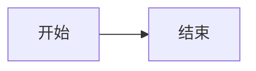

# Mermaid / Pele

`mermaid` fenced code blocks render to inline SVG on the server. Pele 1.6.0
is embedded and runs in Goja; deployment requires neither Node nor a browser.
The vendored bundle is covered by LICENSE.pele. Refresh it with `go generate`.

Colors follow CSS variables and the system dark theme. Layout uses Pele's
built-in text measurement, including Chinese labels. SVG scales to fit the
article; automatic layout changes on browser resize and interactive zoom are
not enabled. The shared JavaScript runtime is serialized and each render has
a three-second execution limit. Invalid diagrams display an escaped error
without preventing the rest of the article from rendering.

Pele uses its own layout and does not support arbitrary HTML labels or
JavaScript click callbacks. See https://pele.run/compatibility.

## 安全

有，**评论区最需要注意资源消耗，其次是图片和链接策略**。对照[官方安全说明](https://pele.run/security)和当前实现，发现这些点：

- **单张超时不等于整体限流。** 现在每张图最多运行 3 秒，但所有渲染共用一个 Goja 锁；一条评论塞入多张复杂图，可能持续占用渲染资源，拖慢文章和其他评论。应限制每条评论的图表数量、总源码长度，并降低评论图表的节点边数、输出大小。
- **明确关闭评论图表中的图片。** 官网提醒 SVG 图片展示时会发起网络请求，可用于追踪读者；现有图片处理只检查 HTML `img`，覆盖不到 SVG `image`。评论建议固定 `images: false`；链接可关闭，或设置 `noopener noreferrer nofollow ugc`。
- **不能只用 `secure` 判断评论权限。** 评论发表检查、预览使用用户权限，但缓存展示时会以 `secure=true` 重新渲染。因此评论限制必须覆盖所有阶段，不能仅放在 `!secure` 分支。

现有接入中做对的部分：错误信息经过 HTML 转义；没有提供自定义图标或内部链接处理器；作者无法直接传入渲染 options。简单的 HTML 标签和 `javascript:` 注入测试也没有产生可执行内容。不过这不等于完成了全面安全审计。

还有一个版本问题：在线安全说明可能比我们固定的 **1.6.0** 更新，应显式设置安全选项，并用测试验证，避免依赖默认值。

这轮未修改代码。建议先补上**评论专用限制、禁用图片和总渲染预算**，再开放评论区使用。
